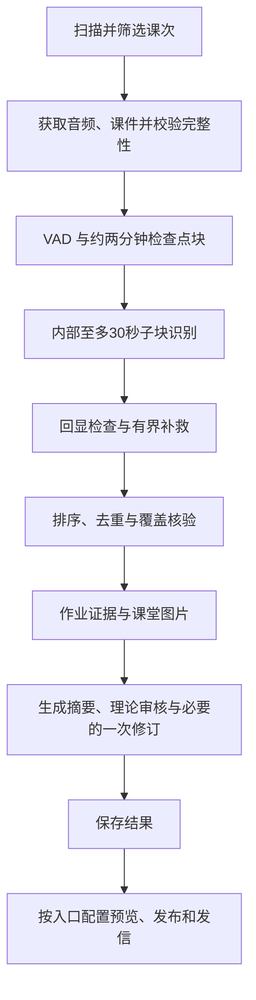

# iCourseNotes

把复旦大学 iCourse 的课堂录播整理成中文课程笔记：每堂课自动生成带公式、课堂原图和作业提醒的结构化笔记，可以在 Mac 应用或网页里阅读、导出 PDF，也可以每天按邮件收到。

> 本项目基于 LeafCreeper/Fudan_iCourse_Subscriber 独立维护。请遵守传播说明，避免在树洞、班级群、大群或社交媒体等渠道发布或推广。项目用于本人有权访问的课程和个人学习。[上游仓库](https://github.com/LeafCreeper/Fudan_iCourse_Subscriber) · [来源与传播说明](docs/upstream-permission.md)

[下载 macOS 应用](https://github.com/Lucasuiii/iCourseNotes/releases/latest) · [打开笔记网页](https://lucasuiii.github.io/iCourseNotes/) · [Mac 安装与运行](docs/local-history-refresh.md) · [个人部署](PERSONAL_DEPLOYMENT.md)

## 能做什么

- **一堂课一份笔记**：按课堂顺序整理要点、定义、定理和推导，公式用 LaTeX 渲染；课堂板书和课件截图放在对应位置，并标注录播时间。
- **作业和课务提醒**：老师布置的作业、截止时间和课务安排放在笔记开头；作业页码和题号会对照板书与口述核对，不一致时标注“待核对”。
- **把关内容质量**：识别缺口会在笔记里注明；摘要生成后再做一轮理论审核，发现概念、公式或史实错误时修订一次。
- **随处阅读**：Mac 应用离线阅读和批量导出 PDF；网页在浏览器里解密阅读；每日任务把新笔记以 HTML 邮件加 PDF 附件发送。
- **两种识别方式**：Apple Silicon Mac 本机识别（快，可以先审核再发布），或 GitHub Actions 每天定时在云端识别（不占用自己的电脑）。

## 怎么用

按需要选一种，三种可以同时使用，笔记都保存在同一个加密的 `data` 分支里。

| 方式 | 适合 | 需要准备 |
| --- | --- | --- |
| 只阅读 | 已经有人在维护这个仓库的笔记 | 数据库密钥 |
| Mac 应用 | 自己识别、审核后再发布 | Apple Silicon Mac、本机识别环境 |
| 云端每日任务 | 每天自动出笔记、发邮件 | GitHub 账号、复旦账号、模型服务密钥 |

### 只阅读

- **网页**：打开[笔记网页](https://lucasuiii.github.io/iCourseNotes/)，输入数据库密钥或选择本机密钥文件，就能按课程浏览、导出 Markdown 或打印 PDF。
- **Mac 应用**：在“同步”页点“拉取最新”，笔记解密后加密缓存在本机，之后可以离线阅读。

### Mac 应用

1. 从 [Releases](https://github.com/Lucasuiii/iCourseNotes/releases/latest) 下载 `iCourseNotes-macOS-*-arm64.zip`，解压后放在项目根目录（与 `work/` 同级），或首次打开时选择项目目录。应用是本机临时签名，第一次请在 Finder 里右键“打开”。
2. 本机识别环境（Python、模型权重和私密配置）需要先按 [Mac 安装与运行](docs/local-history-refresh.md) 配好一次。
3. **识别**页点“检查新回放”，勾选要识别的课，点“开始识别”。一堂两小时的课大约需要一个多小时，进度、剩余时间和 GPU 占用会实时显示，可以暂停和续跑。
4. 识别完成后到**笔记**页阅读，确认无误点“审核通过”。
5. **同步**页勾选已审核的课，推送到 `data` 分支，可以选择是否发邮件。

工具栏左侧的“待处理”汇总所有需要你处理的事：待审核和待推送的笔记、识别或推送失败、云端每日任务异常。点开可以直接跳到对应位置，打勾表示已知悉，直到出现新情况才会再次提示。[应用说明](macos-app/README.md)

### 云端每日任务

1. 按[个人部署说明](PERSONAL_DEPLOYMENT.md)准备好仓库和运行权限，在 **Settings → Secrets and variables → Actions** 填写下方[配置参考](#配置参考)中的 Secrets。
2. 先做一次预览：打开 **Actions → iCourse Parallel Pilot → Run workflow**，选择 `main`，填写 `validation_course_id`，保留 `validation_lecture_rank=1`，并保持 `publish_results=false`、`send_email=false`。运行后核对课程日期、块数、转录、摘要、作业和配图。
3. 确认没问题后，手动运行 **iCourse Check**，或者等待每日任务。

**iCourse Check** 每天 **18:00（台北时间，UTC+8）** 运行，会正式发布并发邮件。GitHub 的定时任务可能会延迟。已完成的笔记再次扫描时会直接复用。[正式处理链](docs/parallel-course-pilot.md)

## 日常使用

### 阅读和导出

- **Mac 应用**：单篇导出 PDF 时可以附上整理转录；“批量导出”可以按学期、课程或全部导出，每堂一个文件，也可以合并成一个带书签的 PDF。
- **网页**：在课程列表或笔记详情点“导出”，可以下载 Markdown；含图的笔记导出为带 `figures/` 的 ZIP。PDF 通过页内预览和浏览器打印保存，保留公式和课堂原图。
- **密钥保存**：Safari 可以在 Apple“密码”里保存网页地址、用户名 `iCourseNotes` 和数据库密钥，之后由系统自动填充。GitHub 管理操作另需一个只授权本仓库的 PAT。密钥和 PAT 只保存在当前标签页会话中。


### 订阅、筛选和删除

只想识别某些节次时，用下面三个 Secret 控制：

| Secret | 示例 | 作用 |
| --- | --- | --- |
| `COURSE_SESSION_RULES` | `12345=周一第1-2节\|周三第6-8节` | 白名单：只识别这些节次 |
| `COURSE_SESSION_EXCLUSIONS` | `12345=周一第6-10节` | 固定排除，与节次有重叠就排除 |
| `COURSE_SESSION_OVERRIDE_DATES` | `2026-09-20,2026-10-01` | 调课日期不受白名单限制，排除规则仍然生效 |

白名单和排除规则都支持每行写一门课程，格式写错时任务会停止并报告错误类型。

网页首页课程的“删除”会先取消订阅，再提交清理该课程数据的任务。课程内的“删除并永久忽略”会清除选定课次的内容，并记下忽略标记，以后扫描时跳过。结果不明确时，先查看对应的 Actions 运行。

### 出问题时

- **识别中断**：已识别的块、音频指纹和审核记录都随检查点保存。Mac 应用里点“继续”从断点续跑，已完成的部分不会重跑；准备阶段失败的课可以直接重新开始。
- **摘要阶段失败**：可以复用已完成的识别结果，不需要重新识别。
- **云端失败**：Mac 应用的“待处理”会提示，点开直接进入对应的运行记录。加密的 Actions artifacts 保留 7 天；连续失败的课次后续仍会继续扫描，失败提醒按邮件配置去重。[共享队列](docs/shared-asr-queue.md) · [资源恢复](docs/signed-media-transport.md)

## 工作原理

本机和云端共用同一套处理规则，只有模型运行的硬件不同：Mac 用 MLX，云端 Runner 用 PyTorch CPU，模型都是 Qwen3-ASR-1.7B。Windows CUDA 本地后端尚未实现。



| 环节 | 当前行为 |
| --- | --- |
| 音频获取 | 默认 `aac_auto`，按 MP4 范围定位 AAC，验证来源、packet 覆盖和原时间轴，输出 16 kHz 单声道；支持反相声道检测。云端一次只获取一堂课的音频 |
| 分块与识别 | VAD 跳过长段无语音，约两分钟一块并保存检查点，块内在低能量处切成至多 30 秒的片段 |
| 回显补救 | 拼接前检查提示词回显，异常时整块不带提示重新识别，受时限、调用次数和缺口规则约束 |
| 术语 | 历史确认术语优先，基础词表补充，合计最多 30 项；排除当前、未来和已删除课次的历史证据 |
| 图像 | 课件 OCR、作业附近多帧读取、精选课堂原图；平台图和作业图随检查点恢复 |
| 作业核对 | 板书读出的页码、题号与作业前后的课堂口述对照，冲突时标注待核对 |
| 审核 | 检查概念、公式、条件、推导和史实；发现明确问题后修订一次，保留原问题、响应和识别缺口提示 |
| 数据 | 加密分片存于 `data` 分支，按课次合并，记录处理状态、删除标记和邮件回执 |

音频获取、VAD 和语音识别在选定的 Mac 或 Runner 上执行。摘要、作业图片理解和理论审核调用配置的模型服务，这些步骤会发送课堂文字和所需图片。

同一堂课使用冻结的输入和词表。官方字幕只作为低可信度的辅助材料。课程名称与基础术语映射保存在 `prompts/course_glossary.enc`，云端用 `DB_ENCRYPTION_KEY` 解密；本机优先读取 `.local-history-refresh/course_glossary.json`，也可以用 `COURSE_GLOSSARY_PATH` 指定路径。[识别流程维护](docs/recognition-pipeline.md) · [AAC 获取](docs/aac-production-integration.md) · [术语证据规则](docs/automatic-course-glossary.md)

理论审核发现明确问题后，DeepSeek 根据原稿、问题和材料修订一次。`revised` 表示已完成这次修订，最终内容仍可人工审阅。修订设置了 32,000 token 上限并关闭思考；截断、超时或无效回复会保留失败现场，因校验规则过严被拒的回复可在规则修正后直接复核，不再重复调用模型。[审核实现](src/pipeline/summary_review.py)

## 配置参考

### 账号与课程

| Secret | 用途 |
| --- | --- |
| `STUID` | 复旦学号 |
| `UISPSW` | UIS 密码 |
| `UIS_OTP_SECRET` | 账号绑定了动态口令时使用的 TOTP 种子 |
| `COURSE_IDS` | 课程 ID，用英文逗号分隔 |
| `DB_ENCRYPTION_KEY` | 数据库和仓库内加密配置使用的随机密钥 |

课程 ID 可以从 iCourse 课程网址里找到。


新部署可以在本机生成数据库密钥，备份好后填入 Secret。已有数据必须使用原来的密钥，更换密钥需要迁移数据。

```bash
openssl rand -hex 32
```

### 模型服务

至少配置一种文字模型服务。配图和理论审核使用 DeepSeek。

| Secret | 服务 |
| --- | --- |
| `DASHSCOPE_API_KEY` | ModelScope 文字模型，变量名为兼容旧配置而保留 |
| `DEEPSEEK_API_KEY` | DeepSeek 文字、作业图片理解、选图和理论审核 |
| `GEMINI_API_KEY` | Gemini 文字模型 |
| `DOUBAO_ASR_API_KEY` | 可选，补救识别缺口 |
| `TAVILY_API_KEY` | 可选，检索公共知识疑点 |

服务地址可以用 `DASHSCOPE_BASE_URL`、`DEEPSEEK_BASE_URL`、`GEMINI_BASE_URL` 配置。模型名称、调用顺序和兼容要求以[运行配置](src/runtime/config.py)为准，费用和额度以服务商为准。

### 邮件

| Secret | 用途 |
| --- | --- |
| `SMTP_EMAIL` | QQ 发件邮箱 |
| `SMTP_PASSWORD` | QQ 邮箱 SMTP 授权码 |
| `RECEIVER_EMAILS` | 收件地址，可以用逗号、分号或换行分隔 |
| `RECEIVER_EMAIL` | 兼容旧部署的单个收件地址 |

邮件按课程发送，包含 HTML 正文和 PDF。PDF 生成失败时改发 Markdown，有配图时附带 JPEG ZIP。SMTP 回执只表示服务器接受了邮件，投递结果不明确时仍需核对。

### Mac 命令行

不用应用时，也可以直接用命令行完成本机识别。需要 Apple Silicon Mac、Python、Git、GitHub CLI、FFmpeg、MLX bf16 权重和 Silero VAD 文件；已验证的双块运行库为 `mlx-qwen3-asr==0.4.4`。

```bash
git clone https://github.com/Lucasuiii/iCourseNotes.git
cd iCourseNotes
python3 -m venv .venv-local
.venv-local/bin/python -m pip install -r requirements-local-mlx.txt
cp .env.example .env.local
chmod 600 .env.local
```

在 `.env.local` 里填写校园账号、订阅课程、数据库密钥和模型服务，然后先检查环境，再处理一堂课：

```bash
./local-history.command --env-file .env.local --automatic-terms --mlx-batch-size 2 doctor
./local-history.command --env-file .env.local --automatic-terms --mlx-batch-size 2 plan --limit 1
./local-history.command --env-file .env.local --automatic-terms --mlx-batch-size 2 run --hours 2
./local-history.command --env-file .env.local --automatic-terms --mlx-batch-size 2 status
./local-history.command --env-file .env.local --automatic-terms --mlx-batch-size 2 review
```

`plan --limit 1` 选择一堂已发布的历史课次生成对照稿；新课用 `plan --new-lecture <课次ID> --course-id <课程ID> --date YYYY-MM-DD` 生成本地预览。历史稿核对后用 `apply --approval <覆盖指纹>` 发布，发布时按单堂课合并，并验证基线、备份、加密往返和远端状态。恢复时沿用同一运行目录和参数。更换源码版本时使用独立目录，已经启动的任务按原版本恢复。[本地预览、恢复及发布](docs/local-history-refresh.md) · [历史更新](docs/historical-refresh.md)

## 开发与维护

核心规则集中在 `src/`，本机命令行和 Actions 各阶段调用同一套实现；后端分别负责 CPU、MLX 和双路模型执行。维护时需要同时测试本机与云端的正常入口、旧检查点和数据完整性。

```bash
python -m unittest discover -s tests
```

Mac 上已有共享环境时可以运行 `scripts/ci_local.sh`。测试需要 Python 和 Node 依赖，PDF 测试还需要字体、Pango 和 Cairo。macOS 应用源码和构建脚本在 `macos-app/`。[Python 依赖](requirements.txt) · [前端依赖](package.json) · [CPU 运行环境](.github/actions/qwen-pilot-runtime/action.yml)

自动化测试覆盖模拟模型、临时 HTTP 服务、SQLite、加密和 Git 恢复。完整课堂的准确性、题号和图文对应仍需用真实课程验证。MLX bf16 和 CPU float32 的数值路径与调度不同，转录结果可能有细节差异。

## 文档导航

| 文档 | 内容 |
| --- | --- |
| [本机安装与运行](docs/local-history-refresh.md) | Mac 环境、权重、入口、预览、续跑和历史发布 |
| [macOS 应用](macos-app/README.md) | 三个页面、待处理、审核与推送 |
| [个人部署](PERSONAL_DEPLOYMENT.md) | Secrets、权限、数据操作与停用 |
| [共用识别流程](docs/recognition-pipeline.md) | 两端调用链、质量规则、资源恢复及兼容约定 |
| [处理链代码结构](docs/pipeline-architecture.md) | 核心模块与运行入口 |
| [正式处理链](docs/parallel-course-pilot.md) | 规划、识别、汇总和发布 |
| [共享 ASR 队列](docs/shared-asr-queue.md) | 动态领块、协调分支与恢复 |
| [作业与课务复核](docs/homework-review.md) | 多帧图像、题号依据与摘要保留 |
| [课程术语库](docs/automatic-course-glossary.md) | 候选、确认、日期隔离与冻结 |
| [媒体签名与范围续传](docs/signed-media-transport.md) | 完整音频获取和源标识验证 |
| [迁移与运行边界](docs/standalone-migration.md) | 独立部署时的边界与约定 |
| [隔离分片对照](docs/qwen-sharded-pilot.md) | 实验入口与验证方式 |
| [早期设计记录](docs/legacy-design.md) | 历史调度与识别方案 |

## 许可证

项目代码采用 MIT 许可证。随附的第三方组件沿用各自的许可证和版权声明。[MIT LICENSE](LICENSE)
