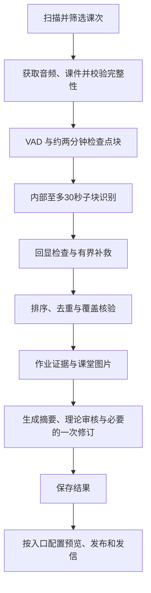

# iCourseNotes

将复旦大学 iCourse 录播、课件和板书整理成中文课程笔记，支持 Apple Silicon 本机识别、GitHub Actions CPU 识别、课堂配图、理论审核、加密同步和邮件。

> 本项目基于 LeafCreeper/Fudan_iCourse_Subscriber 独立维护。请遵守传播说明，避免在树洞、班级群、大群或社交媒体等渠道发布或推广。项目用于本人有权访问的课程和个人学习。[上游仓库](https://github.com/LeafCreeper/Fudan_iCourse_Subscriber) · [来源与传播说明](docs/upstream-permission.md)

[下载 macOS 应用](https://github.com/Lucasuiii/iCourseNotes/releases/latest) · [打开笔记网页](https://lucasuiii.github.io/iCourseNotes/) · [Mac 安装与运行](docs/local-history-refresh.md) · [个人部署](PERSONAL_DEPLOYMENT.md) · [共用流程维护](docs/recognition-pipeline.md)

## 选择使用方式

| 方式 | 识别与调度 | 阅读和交付 |
| --- | --- | --- |
| Mac 本机 | Qwen3-ASR-1.7B / MLX，单模型串行或双块文本解码 | 本地预览和审核，按入口操作发布 |
| GitHub Actions | Qwen3-ASR-1.7B / PyTorch CPU，共享 Runner 队列 | 预览模式或正式发布，邮件由开关控制 |
| GitHub Pages | 浏览器解密 `data` 分支中的笔记 | 课程阅读、公式与配图、导出、订阅和删除 |

本地与云端共用回显检测、补救规则、术语策略、材料组装、摘要、作业读图、配图和理论审核。硬件适配器分别负责模型执行，调度和存储由运行环境管理。Windows CUDA 本地后端仍待实现。

音频获取、VAD 和 ASR 在选定的 Mac 或 Runner 上执行。摘要、作业视觉理解和理论审核使用配置的模型服务，相关步骤会发送课堂文字及所需图片。图片理解使用独立的 DeepSeek 路由，文字生成按配置的服务商顺序调用。[运行配置](src/runtime/config.py)

## 共用处理流程



| 环节 | 当前行为 |
| --- | --- |
| 音频获取 | 默认 `aac_auto`，按 MP4 范围定位 AAC，验证来源、packet 覆盖和原时间轴，输出 16 kHz 单声道；支持反相声道检测 |
| 分块与识别 | VAD 跳过长无语音间隔，约两分钟块保留检查点，内部按低能量位置切成至多30秒片段 |
| 回显补救 | 拼接前检查提示词回显，异常时用完整原块无提示重识别，继续受时限、调用次数和缺口规则约束 |
| 术语 | 历史确认术语优先，基础词表补充，合计最多30项；排除当前、未来及已删除课次的历史证据 |
| 图像 | 课件 OCR、作业附近多帧读取、精选课堂原图；平台图与作业图随检查点恢复 |
| 审核 | 检查概念、公式、条件和推导；发现明确问题后修订一次，保留原问题与响应 |
| 数据 | 加密分片存于 `data`，按课次合并，记录处理状态、删除标记和邮件回执 |

具体课程名称与基础术语映射保存在 `prompts/course_glossary.enc`，云端使用 Secrets 中的 `DB_ENCRYPTION_KEY` 解密。本地优先读取 `.local-history-refresh/course_glossary.json` 明文私密文件，也可用 `COURSE_GLOSSARY_PATH` 指定路径。

同堂课使用冻结的输入和词表。官方字幕作为低可信辅助材料。新任务默认启用自动术语，显式关闭选项仍可使用。ASR 普通解码和补救的输出预算均为每推理片段2048 token。[识别流程维护](docs/recognition-pipeline.md) · [AAC 获取](docs/aac-production-integration.md) · [术语证据规则](docs/automatic-course-glossary.md)

## Mac 本机开始

需要 Apple Silicon Mac、Python、Git、GitHub CLI、FFmpeg，以及 MLX bf16 权重和 Silero VAD 文件。已验证的双块运行库为 `mlx-qwen3-asr==0.4.4`。完整安装、模型路径和私密配置见本机说明。[Mac 安装与运行](docs/local-history-refresh.md)

```bash
git clone https://github.com/Lucasuiii/iCourseNotes.git
cd iCourseNotes
python3 -m venv .venv-local
.venv-local/bin/python -m pip install -r requirements-local-mlx.txt
cp .env.example .env.local
chmod 600 .env.local
```

在 `.env.local` 配置校园账号、订阅课程、已有数据库密钥和模型服务。使用已有 `data` 时填写其对应密钥。先检查环境，再选择和处理一堂课。

```bash
./local-history.command --env-file .env.local --automatic-terms --mlx-batch-size 2 doctor
./local-history.command --env-file .env.local --automatic-terms --mlx-batch-size 2 plan --limit 1
./local-history.command --env-file .env.local --automatic-terms --mlx-batch-size 2 run --hours 2
./local-history.command --env-file .env.local --automatic-terms --mlx-batch-size 2 status
./local-history.command --env-file .env.local --automatic-terms --mlx-batch-size 2 review
```

这里的 `plan --limit 1` 选择已发布的历史课次生成对照稿。新课使用 `plan --new-lecture <课次ID> --course-id <课程ID> --date YYYY-MM-DD`，生成本地预览。历史稿核对后可用 `apply --approval <覆盖指纹>` 发布。恢复时沿用同一运行目录和参数。[本地预览、恢复及发布](docs/local-history-refresh.md)

macOS 应用源码和构建脚本位于 `macos-app/`，安装包见 Releases。[应用说明](macos-app/README.md)

本机应用通过本地识别入口调用运行环境。更换源码版本时使用独立目录，已启动的冻结任务沿原版本恢复。完整转录、整理转录、精选图与审核记录应随课程结果保存。

## GitHub Actions 开始

先配置个人部署与运行权限，再在 **Settings → Secrets and variables → Actions** 填写 Repository secrets。首次使用建议选择一门课完成预览。[个人部署说明](PERSONAL_DEPLOYMENT.md) · [迁移与运行边界](docs/standalone-migration.md)

### 账号与课程

| Secret | 用途 |
| --- | --- |
| `STUID` | 复旦学号 |
| `UISPSW` | UIS 密码 |
| `UIS_OTP_SECRET` | 账号已绑定且登录要求动态口令时使用的 TOTP 种子 |
| `COURSE_IDS` | 课程 ID，英文逗号分隔 |
| `DB_ENCRYPTION_KEY` | 数据库及仓库加密课程配置使用的随机密钥 |

课程 ID 可从 iCourse 课程网址取得。


新部署可在本机生成数据库密钥，妥善备份后填入 Secret。已有数据须使用对应密钥，更换密钥需要迁移数据。

```bash
openssl rand -hex 32
```

### 模型服务

至少配置一种文字模型服务。配图和理论审核使用配置的 DeepSeek 路由。

| Secret | 服务 |
| --- | --- |
| `DASHSCOPE_API_KEY` | ModelScope 文字模型，变量名称保留历史兼容 |
| `DEEPSEEK_API_KEY` | DeepSeek 文字、作业图片理解、选图及理论审核 |
| `GEMINI_API_KEY` | Gemini 文字模型 |
| `DOUBAO_ASR_API_KEY` | 可选，识别缺口补救 |
| `TAVILY_API_KEY` | 可选，公共知识疑点检索 |

服务地址可通过 `DASHSCOPE_BASE_URL`、`DEEPSEEK_BASE_URL`、`GEMINI_BASE_URL` 配置。模型名称、顺序和兼容要求以运行配置为准，费用和额度以服务商为准。[运行配置](src/runtime/config.py)

### 邮件

| Secret | 用途 |
| --- | --- |
| `SMTP_EMAIL` | QQ 发件邮箱 |
| `SMTP_PASSWORD` | QQ 邮箱 SMTP 授权码 |
| `RECEIVER_EMAILS` | 收件地址，支持逗号、分号或换行分隔 |
| `RECEIVER_EMAIL` | 兼容旧部署的单个收件地址 |

邮件按课程发送，包含 HTML 正文及 PDF。PDF 生成失败时回退 Markdown，有配图时附带 JPEG ZIP。公式在运行环境渲染。SMTP 回执表示服务器接受邮件，客户端遇到未知投递结果时仍需核对。

### 先预览，再运行订阅

1. 打开 **Actions → iCourse Parallel Pilot → Run workflow**，选择 `main`。
2. 填写 `validation_course_id`，保留 `validation_lecture_rank=1`，选择最新实际可播放录播。
3. 保持 `publish_results=false`、`send_email=false`，运行后核对课程日期、块数、转录、摘要、作业和配图。
4. 确认配置后运行 **iCourse Check**，或等待日常任务。

`iCourse Check` 每天 **18:00（台北时间，UTC+8）**运行，配置为正式发布并发邮件。GitHub 定时任务可能延迟。未填写单课验证参数的 Parallel Pilot 会按订阅范围规划课次。已完成摘要在再次扫描时复用。[正式处理链](docs/parallel-course-pilot.md)

## 日常使用

### 阅读和导出

笔记网页读取 `data` 分支，在浏览器内使用数据库密钥解密。可输入密钥或选择本机密钥文件。GitHub 管理操作另填仅授权本仓库的 PAT，密钥与 PAT 按当前页面实现保存在标签页会话中。

在课程列表或笔记详情点击“导出”，可下载 Markdown，含图时导出带 `figures/` 的 ZIP。PDF 通过页内预览与浏览器打印保存，保留公式和课堂原图。

Safari 可在 Apple“密码”中保存网页网址、用户名 `iCourseNotes` 和数据库密钥，之后由系统提供自动填充。GitHub Pages 配置完成后，手动运行 **Deploy Frontend** 部署。[网页入口](https://lucasuiii.github.io/iCourseNotes/) · [部署工作流](.github/workflows/deploy-frontend.yml)


### 订阅、筛选和删除

| Secret | 示例 | 行为 |
| --- | --- | --- |
| `COURSE_SESSION_RULES` | `12345=周一第1-2节\|周三第6-8节` | 课次白名单 |
| `COURSE_SESSION_EXCLUSIONS` | `12345=周一第6-10节` | 固定排除，与课次重叠即排除 |
| `COURSE_SESSION_OVERRIDE_DATES` | `2026-09-20,2026-10-01` | 调课日期绕过白名单，排除规则继续生效 |

白名单和排除支持每行一门课程。格式错误时任务停止并报告安全错误类型。

网页首页课程的“删除”先取消订阅，再提交清理该课程数据的任务。课程内的“删除并永久忽略”清除选定课次内容，并保存忽略标记供后续扫描使用。操作完成后刷新读取最新数据，结果未知时先检查对应 Actions。已经启动的冻结任务需要单独查看状态。

### 故障与恢复

成功识别块、音频指纹和复核记录随检查点保存。摘要阶段失败时可复用已完成 ASR，未知结果的模型调用保留其预留记录。缺失、过期或输入不一致的检查点会报告具体错误。

云端正式流程的加密 Actions artifacts 保留7天，共享队列和派发分支记录任务状态。清理协调分支前确认任务结束、恢复窗口和所需结果。连续失败课次后续仍会扫描，失败提醒按邮件配置去重。[共享队列](docs/shared-asr-queue.md) · [资源恢复](docs/signed-media-transport.md)

### 历史覆盖与交付

历史课程先生成原稿与新稿对照，核对后凭覆盖指纹应用。发布按单堂课范围合并，验证基线、备份、加密往返及远端状态。普通快进推送发生竞争时重新读取远端。[历史更新](docs/historical-refresh.md)

摘要理论审核发现明确问题后，DeepSeek 根据原稿、问题和材料修订一次。`revised` 表示完成该次修订，最终内容仍可人工审阅。审核范围、原稿、响应和正文指纹保留用于追查。普通摘要和理论审核采用服务输出额度，修订当前显式设置32,000 token上限并关闭思考。截断、超时或无效回复会保留失败现场。[审核实现](src/pipeline/summary_review.py)

## 开发与维护

核心规则集中在 `src/`，本地 CLI 和 Actions 阶段调用共用实现。后端分别负责 CPU、MLX 和双路模型执行。维护时同时测试本地与云端正常入口、旧检查点和数据完整性。

```bash
python -m unittest discover -s tests
```

Mac 已有共享环境时可运行 `scripts/ci_local.sh`。测试需要 Python、Node 依赖，PDF 测试还需要字体、Pango 和 Cairo。CPU 识别模型环境由专用 Actions 配置安装，本地 MLX 依赖见 `requirements-local-mlx.txt`。[Python 依赖](requirements.txt) · [前端依赖](package.json) · [CPU 运行环境](.github/actions/qwen-pilot-runtime/action.yml)

自动化测试覆盖模拟模型、临时 HTTP 服务、SQLite、加密与 Git 恢复。完整课堂的准确性、题号和图文对应还需实际课程验证。MLX bf16 与 CPU float32 的数值路径和执行调度可能产生具体转录差异。

## 文档导航

| 文档 | 内容 |
| --- | --- |
| [本机安装与运行](docs/local-history-refresh.md) | Mac 环境、权重、入口、预览、续跑和历史发布 |
| [共用识别流程](docs/recognition-pipeline.md) | 两端调用链、质量规则、资源恢复及兼容约定 |
| [处理链代码结构](docs/pipeline-architecture.md) | 核心模块与运行入口 |
| [个人部署](PERSONAL_DEPLOYMENT.md) | Secrets、权限、数据操作与停用 |
| [正式处理链](docs/parallel-course-pilot.md) | 规划、识别、汇总和发布 |
| [共享 ASR 队列](docs/shared-asr-queue.md) | 动态领块、协调分支与恢复 |
| [作业与课务复核](docs/homework-review.md) | 多帧图像、题号依据与摘要保留 |
| [课程术语库](docs/automatic-course-glossary.md) | 候选、确认、日期隔离与冻结 |
| [媒体签名与范围续传](docs/signed-media-transport.md) | 完整音频获取和源标识验证 |
| [隔离分片对照](docs/qwen-sharded-pilot.md) | 实验入口与验证方式 |
| [早期设计记录](docs/legacy-design.md) | 历史调度与识别方案 |

## 许可证

项目代码采用 MIT 许可证。随附的第三方组件沿用各自许可证和版权声明。[MIT LICENSE](LICENSE)
